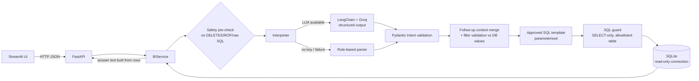

# AI-Powered Business Intelligence Assistant

Ask questions about sales data in plain English and get answers backed by **real database queries**.
An LLM (Groq, via LangChain) only *interprets* the question into a validated, structured intent.
The numbers always come from **approved, parameterised, read-only SQL** — the model never writes SQL
and never calculates an answer.

Built for the *AI-Assisted Development Challenge for GET selection* (Python + Generative AI).

| | |
|---|---|
| **Backend** | FastAPI · SQLAlchemy · SQLite · Pandas · Pydantic |
| **AI** | LangChain + Groq (`openai/gpt-oss-20b` in the verified local run; configurable) with structured output; rule-based fallback |
| **Frontend** | Streamlit (chat, charts, SQL inspector, data-quality tab) |
| **Tests** | Pytest — 80 tests, temporary DB, **no API key needed** |

---

## 1. Quick start

Requires **Python 3.10+**. The application was run locally with Python 3.10.12; GitHub Actions is configured to run the test suite on Python 3.13.

```bash
# 1. clone and enter the project
git clone <your-repo-url> ai-bi-assistant
cd ai-bi-assistant

# 2. create a virtual environment and install dependencies
python -m venv .venv
source .venv/bin/activate            # Windows (PowerShell): .venv\Scripts\Activate.ps1
pip install -r requirements.txt

# 3. configure (optional - the app also runs without an LLM key)
cp .env.example .env                 # Windows: copy .env.example .env
#    then edit .env and set GROQ_API_KEY=...   (free key: https://console.groq.com/keys)

# 4. load the supplied CSV into SQLite and print the data-quality report
python3 -m app.ingestion

# 5. start the API  (terminal 1)
python3 -m uvicorn app.main:app --host 127.0.0.1 --port 8000

# 6. start the UI   (terminal 2, same virtualenv)
python3 -m streamlit run frontend/streamlit_app.py
```

* UI: <http://localhost:8501> · API docs (Swagger): <http://localhost:8000/docs>
* Step 4 is optional: the API creates and loads the database automatically on first start if it is empty.
* **No `GROQ_API_KEY`?** The app uses the built-in rule-based interpreter. Every feature still works;
  the response field `interpreter` shows `llm` or `rule_based` so you always know which one answered.

### Run the tests

```bash
python3 -m pytest -q          # 80 tests, ~2 seconds, no network, no API key
```

### Try the API

```bash
curl -s localhost:8000/health
curl -s -X POST localhost:8000/ask -H "Content-Type: application/json" \
     -d '{"question": "Which product generated the highest revenue?"}'
curl -s localhost:8000/analytics/summary
curl -s localhost:8000/analytics/data-quality
```

---

## 2. Architecture



**The key design decision — intent-to-SQL, not text-to-SQL.**
The LLM may only return an `Intent` (one of 9 allowed analyses + optional filters). Each intent maps to a
fixed SQL template; filter values are *bound parameters*. So the model can be wrong about *which analysis* to
run, but it can never produce a destructive or arbitrary query, and it can never invent a number.

| Layer | File | Responsibility |
|---|---|---|
| Config | `app/config.py` | Environment-based settings, no hardcoded secrets |
| Database | `app/db.py` | Schema; separate **write** engine (ingestion) and **read-only** engine (analytics) |
| Ingestion | `app/ingestion.py` | Validate → clean → upsert; rejected rows kept with raw values |
| Data quality | `app/quality.py` | Report computed from what is actually stored |
| Schemas | `app/schemas.py` | Pydantic models: `Intent`, `Filters`, request/response |
| Interpreter | `app/interpreter.py` | LangChain/Groq structured output + rule-based fallback |
| SQL | `app/analytics.py`, `app/sql_guard.py` | Approved templates, parameter binding, guard |
| Pipeline | `app/service.py` | Safety → interpret → context → validate → query → answer |
| API | `app/main.py` | FastAPI endpoints and HTTP status mapping |
| UI | `frontend/streamlit_app.py` | Chat, charts, SQL viewer, data quality |

More detail: [`docs/ARCHITECTURE.md`](docs/ARCHITECTURE.md).

---

## 3. How data is stored and queried

The CSV (`data/sales_data.csv`, 51 rows) is loaded into SQLite (`data/bi_assistant.db`, git-ignored):

* **`transactions`** — one row per transaction, with ISO dates, a derived `month`, and computed
  `gross_revenue`, `net_revenue`, `is_revenue_eligible` and `quality_flag` columns.
* **`rejected_records`** — rows that cannot be loaded (bad date, duplicate ID, negative/non-numeric
  values, missing fields) stored with their **raw values** and the reasons. Nothing is silently discarded.
* **`ingestion_runs`** — audit log of each load.

Ingestion is **repeatable**: it upserts on `transaction_id` inside one DB transaction, so running it again never
creates duplicates. All analytics read `transactions WHERE is_revenue_eligible = 1`.

### Business rules for revenue

| Rule | Detail |
|---|---|
| Net revenue | `Quantity × Unit_price − Discount_amount` (`Discount_amount` is a **line total**, verified against the expected figures) |
| Counted as revenue | `Status = Completed` **and** a valid unit price |
| Returned transactions | Stored, **excluded** from revenue (TXN0033) |
| Missing unit price | Stored, **excluded** from revenue and reported (TXN0051) |
| Zero quantity | Stored and **flagged as an anomaly**; contributes ₹0 (TXN0034) |
| Duplicate transaction IDs | First occurrence kept; later ones go to `rejected_records` (labelled identical/conflicting) |
| Invalid dates | Rejected with the raw row preserved (CSV format `DD-MM-YYYY`) |

### Validation against the assessment's expected figures

| Question | Result |
|---|---|
| Total net revenue | ₹14,39,200 |
| Highest revenue product | Monitor — ₹4,73,000 |
| Highest revenue region | South — ₹4,11,200 |
| Monthly (Jan–Jun) | ₹2,10,250 · ₹2,34,600 · ₹2,23,900 · ₹2,40,700 · ₹3,18,500 · ₹2,11,250 |

These are asserted in the tests **and** cross-checked against an independent pandas calculation.

---

## 4. Supported questions

| Intent | Example |
|---|---|
| `total_revenue` | "What is the total revenue?" |
| `highest_revenue_product` | "Which product generated the highest revenue?" |
| `highest_revenue_region` | "Which region generated the highest sales?" |
| `monthly_revenue_trend` | "What is the monthly revenue trend?" |
| `revenue_comparison` | "How did revenue change between February and March?" |
| `revenue_by_product / region / category / channel` | "Revenue by category" |

**Filters** (combinable): product, region, category, sales channel, date range
— e.g. *"Total revenue for Monitor in the South region"*, *"Q2 revenue for Online sales"*, *"Revenue from February to April"*.

**Follow-ups** (per `session_id`): *"Which region generated the highest revenue?"* → *"What about its monthly trend?"*
applies `region = South`. Explicit filters in the new question always win; a standalone question never inherits context.

---

## 5. API reference

| Method | Path | Purpose | Status codes |
|---|---|---|---|
| POST | `/ask` | `{"question": "...", "session_id": "optional"}` → structured answer | 200 success / no data · 400 unsupported or invalid · 422 empty/oversized · 500 |
| GET | `/health` | Liveness, DB and LLM status | 200 · 503 if DB unavailable |
| GET | `/analytics/summary` | KPIs and breakdowns for the dashboard | 200 |
| GET | `/analytics/data-quality` | Ingestion and anomaly report | 200 |

Example response:

```json
{
  "question": "Which product generated the highest revenue?",
  "status": "success",
  "intent": "highest_revenue_product",
  "filters": {},
  "answer": "Monitor generated the highest revenue among products: ₹4,73,000 (32.9% of ₹14,39,200).",
  "result": {
    "headline": {"product": "Monitor", "revenue": 473000.0, "share_of_total_pct": 32.9, "total_revenue": 1439200.0},
    "rows": [{"label": "Monitor", "revenue": 473000.0, "transactions": 9}, "..."]
  },
  "sql_executed": "SELECT product AS label, ROUND(SUM(net_revenue), 2) AS revenue, COUNT(*) AS transactions FROM transactions WHERE is_revenue_eligible = 1 GROUP BY product ORDER BY revenue DESC, label ASC",
  "sql_parameters": {},
  "interpreter": "llm",
  "context_applied": [],
  "session_id": null
}
```

---

## 6. How unsupported or incorrect answers are prevented

1. **The LLM cannot run SQL.** It outputs an `Intent`; Pydantic rejects anything outside the allowed schema.
2. **Approved templates only.** Each intent has one SQL template. Column names come from fixed dictionaries; values are **bound parameters**.
3. **SQL guard** (second layer): single `SELECT` only, no comments/`;`, forbidden keywords (`DELETE`, `DROP`, `UPDATE`, `INSERT`, …), table allowlist.
4. **Read-only database connection** (`mode=ro` + `PRAGMA query_only`): even a bug cannot write.
5. **Filter values are validated against the database** (case-insensitive). "Total revenue for Banana" → clear error, not a silently wrong total.
6. **Answers are built by code from query results**, never by the LLM — no fabricated figures. Empty results return `no_data`.
7. **Pre-check** refuses data-modifying and raw-SQL requests before the interpreter runs.
8. **Failure fallback:** if the LLM is unavailable or returns invalid output, the rule-based parser answers instead.

---

## 7. Project structure

```
ai-bi-assistant/
├── app/            # backend package (config, db, ingestion, schemas, interpreter, analytics, service, API)
├── frontend/       # Streamlit app
├── data/           # sales_data.csv (supplied dataset); the .db file is generated and git-ignored
├── tests/          # pytest suite
├── docs/           # architecture, AI development notes, interview guide, demo script
├── .github/workflows/ci.yml
├── .env.example  .gitignore  pytest.ini  requirements.txt
```

## 8. Configuration (`.env`)

| Variable | Default | Meaning |
|---|---|---|
| `GROQ_API_KEY` | *(empty)* | Empty → rule-based interpreter only |
| `LLM_MODEL` | `llama-3.3-70b-versatile` (code default) | Any Groq chat model with tool calling. The verified local run used `openai/gpt-oss-20b`. |
| `LLM_TEMPERATURE` | `0` | Deterministic interpretation |
| `LLM_TIMEOUT_SECONDS` | `20` | Per-request timeout; on timeout the fallback answers |
| `DATABASE_PATH` / `DATA_CSV_PATH` | `data/bi_assistant.db` / `data/sales_data.csv` | Storage locations |
| `API_URL` | `http://127.0.0.1:8000` | Used by Streamlit |

Never commit `.env` — it is in `.gitignore`.

## 9. Known limitations

* **Live Groq integration was verified in the local assessment run:** `/health` reported `llm_enabled: true` and model `openai/gpt-oss-20b`; a real `/ask` request returned `interpreter: "llm"`. The automated test suite still uses fake LangChain runnables so it remains deterministic and does not require an API key.
* The rule-based parser handles common phrasings only; unusual wording may return "unsupported" (the LLM path is more flexible).
  Its unknown-entity check is heuristic (capitalised unknown words); lowercase unknown names fall through to a total.
* Follow-up context is in-memory per API process (lost on restart; not shared across workers) and uses simple pronoun/“what about” detection.
* Currency is assumed ₹ (INR); the dataset has no currency column. Data covers Jan–Jun 2026 only.
* Revenue questions only — no profit, forecasting, customer or unit-count analytics (refused with guidance).
* Re-ingestion upserts; transactions removed from a newer CSV are not deleted from the database.
* SQLite and a single process: fine for this scale, not for concurrent production writes.

## 10. More documentation

* [`docs/ARCHITECTURE.md`](docs/ARCHITECTURE.md) — design, request flow, decisions
* [`docs/AI_DEVELOPMENT_NOTES.md`](docs/AI_DEVELOPMENT_NOTES.md) — AI tools used, problems, debugging, next steps
* [`docs/INTERVIEW_GUIDE.md`](docs/INTERVIEW_GUIDE.md) — project-specific interview preparation
* [`docs/DEMO_SCRIPT.md`](docs/DEMO_SCRIPT.md) — 5-minute demonstration
