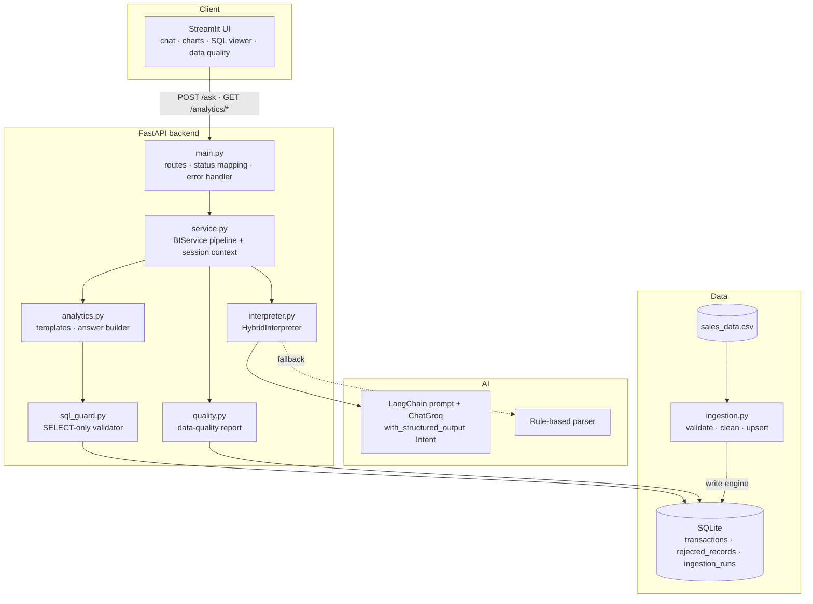

# Architecture

## 1. Goal and constraints

Business users ask questions in natural language; answers must be **correct, explainable and safe**.
The assessment explicitly values correctness, reliability, error handling and the ability to explain the code,
so the design favours **simplicity and determinism** over model autonomy.

## 2. Component diagram



## 3. Request flow for `POST /ask`

1. **FastAPI + Pydantic** parse the body (`AskRequest`): empty or >500 character questions → HTTP 422.
2. **Safety pre-check** (`check_request_safety`): refuses data-modifying verbs and raw SQL syntax → HTTP 400, no query runs.
3. **Context for the interpreter**: real products/regions/categories/channels/months are read from the database so the LLM never guesses spellings.
4. **Interpretation**: `HybridInterpreter` tries the LangChain chain (`prompt | ChatGroq.with_structured_output(Intent)`).
   On any exception — timeout, rate limit, invalid structured output — the rule-based parser answers instead. The response reports which was used.
5. **Pydantic validation** of the `Intent` (allowed intent names, ISO dates, ordered date range, exactly two months for comparisons, blanks like `"all"` normalised to `None`).
6. **Follow-up context** (`apply_context`): only for follow-up-looking questions and only for filters *not* stated explicitly.
7. **Filter validation**: values are matched case-insensitively against what exists in the database; unknown values → HTTP 400 with the available options.
8. **SQL building**: the intent selects one approved template; the WHERE clause is assembled from fixed clause strings; values are bound parameters.
9. **SQL guard** re-validates the final statement; the **read-only engine** executes it.
10. **Answer text** is generated by code from the returned rows. Empty results → `no_data` (HTTP 200) with an honest message.
11. The response (`AskResponse`) includes the answer, headline figures, supporting rows, the exact SQL and its parameters.

## 4. Key decisions

| Decision | Alternative | Why this choice |
|---|---|---|
| **Intent-to-SQL** with fixed templates | Text-to-SQL (LLM writes SQL) | Injection and hallucinated-column risks disappear; behaviour is testable; every answer is explainable. Cost: only anticipated analyses are supported. |
| **Pydantic `Intent` as the LLM contract** | Free-text/JSON parsing with regex | Schema-enforced output; invalid output is rejected, not guessed. |
| **Rule-based fallback** | Fail with HTTP 503 when the LLM fails | The app, demo and test suite work offline and without a key. |
| **Two SQLite engines** (write for ingestion, read-only for analytics) | One engine | Defence in depth: the analytics path physically cannot write. |
| **Store all rows + `is_revenue_eligible` / `quality_flag`** | Drop bad rows at load time | Nothing is silently lost; business rules live in one place (ingestion) and every query shares one predicate. |
| **Answer text built in code** | Let the LLM phrase the answer | The model never sees or touches the numbers → cannot fabricate them. |
| **No LangGraph** | Multi-node agent graph | The flow is a short, linear pipeline; a graph would add concepts without adding capability (see the interview guide for where it *would* fit). |
| **SQLAlchemy Core with bound `text()`** | ORM | Analytics queries are aggregations; plain parameterised SQL is clearer to read and to show to users. |
| **In-memory session store** | Redis/DB | Enough for a single process; documented limitation. |

## 5. Database design

```
transactions(
  transaction_id PK, order_date ISO, month 'YYYY-MM', product, category, region, sales_channel,
  quantity INT >=0, unit_price REAL NULL >=0, discount_amount REAL >=0, status,
  gross_revenue, net_revenue, is_revenue_eligible 0/1, quality_flag)
rejected_records(id, source_row, transaction_id, reasons, raw_record JSON, ingested_at)
ingestion_runs(id, run_at, source_file, rows_read, rows_loaded, rows_rejected)
```

* `CHECK` constraints enforce non-negative quantities/prices at the database level.
* Indexes on `month`, `region`, `product` (the common group/filter columns).
* Revenue is **precomputed at ingestion**, so the single rule `net = qty × price − discount` exists in exactly one place.

## 6. Error-handling map

| Situation | Outcome |
|---|---|
| Empty / oversized / malformed request | 422 (Pydantic) |
| Unsupported topic, destructive or raw-SQL request | 400, `status: unsupported`, guidance text |
| Unknown product/region/category/channel | 400, `status: invalid`, lists valid values |
| Valid question, no matching rows | 200, `status: no_data` |
| LLM timeout / error / invalid output | Logged; rule-based parser answers; `interpreter: rule_based` |
| Database unreachable | `/health` → 503; other endpoints → 500 with a generic message (details only in logs) |
| CSV missing a required column | Ingestion fails fast with a clear message |

## 7. Production considerations (not implemented, by design)

* Replace SQLite with PostgreSQL/RDS; keep the same templates (use `date_trunc` instead of the stored `month`, or keep the derived column).
* Secrets in AWS Secrets Manager; model access through the Groq API or Amazon Bedrock behind the same `Interpreter` interface.
* Deploy FastAPI on ECS Fargate / App Runner (or Lambda with an ASGI adapter); Streamlit as a separate service; CSVs landing in S3 trigger ingestion.
* Replace in-memory sessions with Redis; add authentication, rate limiting, request IDs and structured JSON logs; add metrics (latency, fallback rate, unsupported rate).
* CI already runs the test suite; add linting, type checking and a container build.
